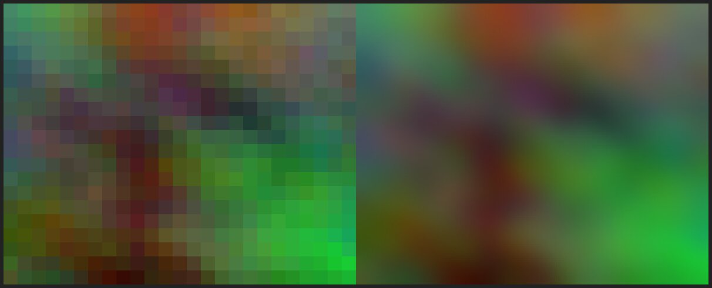

# rmblur · media_clean

[](https://github.com/khahdihdz/rmblur/actions/workflows/ci.yml)
[](LICENSE)


Script menu cho **Termux** để xoá watermark tĩnh, **khử mosaic/pixel** và làm nét ảnh/video
bằng `ffmpeg`, `ImageMagick` và `OpenCV` (tuỳ chọn). Không cần root, chạy tốt trên ARM64.

> **Phạm vi sử dụng:** chỉ dùng cho nội dung bạn sở hữu hoặc có quyền chỉnh sửa.
> Xoá watermark hay gỡ làm mờ của nội dung do người khác tạo có thể vi phạm bản quyền,
> quyền riêng tư và điều khoản dịch vụ.

---

## Cài đặt nhanh

```bash
pkg install -y ffmpeg imagemagick python
curl -fsSL https://raw.githubusercontent.com/khahdihdz/rmblur/main/get.sh | bash
media_clean
```

Hoặc clone rồi cài:

```bash
git clone https://github.com/khahdihdz/rmblur.git
cd rmblur && bash install.sh
```

Chạy trực tiếp không cài:

```bash
curl -LO https://raw.githubusercontent.com/khahdihdz/rmblur/main/media_clean.sh
chmod +x media_clean.sh && ./media_clean.sh
```

Kiểm tra phụ thuộc: `media_clean --check`

---

## Tính năng

| Nhóm | Chức năng |
|------|-----------|
| Ảnh | Xoá watermark bằng inpaint (OpenCV TELEA) hoặc ImageMagick |
| Ảnh | **Khử mosaic/pixel**: làm mềm cạnh khối, hoặc lấp vùng bằng inpaint |
| Ảnh/Video | **Tự phát hiện vùng mờ/mosaic** thay vì nhập toạ độ thủ công (`--auto`) |
| Video | Xoá watermark bằng filter `delogo`, giữ nguyên audio (`-c:a copy`) |
| Video | **Khử mosaic/pixel** theo vùng: crop → scale xuống → scale lên → boxblur → overlay |
| Chung | Làm nét bằng `unsharp` cho ảnh và video |
| Hàng loạt | Quét cả thư mục, chọn chế độ watermark hoặc mosaic, báo `[i/N]` và tổng kết |
| Hỗ trợ | Xem trước frame để lấy toạ độ, preset, log từng lần chạy, CLI cho scripting |

### Demo khử mosaic



*Trái: vùng mosaic. Phải: sau khi khử — cạnh khối được làm mềm, nhưng chi tiết gốc không thể phục hồi.*

---

## Menu

```
1) Ảnh: xoá watermark + làm nét
2) Video: xoá watermark + làm nét
3) Ảnh: khử mosaic/pixel (blur dạng khối)
4) Video: khử mosaic/pixel (blur dạng khối)
5) Hàng loạt ảnh trong thư mục
6) Hàng loạt video trong thư mục
7) Xem trước / chọn toạ độ vùng
8) Preset
9) Kiểm tra & cài phụ thuộc
10) Cài đặt mặc định
11) Xem log gần nhất
0) Thoát
```

Khi được hỏi vùng, menu 3/4 cho chọn **tự động phát hiện** (mặc định) hoặc **nhập tay**.
Nhập tay dùng dạng `x:y:w:h` (pixel, gốc toạ độ góc trên-trái), nhiều vùng liên tiếp,
Enter trống để kết thúc.

---

## CLI

```bash
media_clean image FILE [x:y:w:h ...] [--deblur] [--out DIR]
media_clean video FILE [x:y:w:h ...] [--deblur] [--out DIR] [--crf N]

media_clean depixel-image FILE [x:y:w:h ...] [--block N] [--fill] [--deblur] [--out DIR]
media_clean depixel-video FILE [x:y:w:h ...] [--block N] [--fill] [--deblur] [--out DIR]
media_clean depixel-image FILE --auto [--fill] [--block N] [--out DIR]
media_clean depixel-video FILE --auto [--fill] [--block N] [--out DIR]

media_clean --check | --help | --version
```

Ví dụ:

```bash
# Xoá logo góc phải trên của clip dọc
media_clean video clip.mp4 900:20:180:60 --crf 20

# Nhiều vùng + làm nét
media_clean video in.mp4 940:12:180:60 20:60:120:40 --deblur --out ~/out

# Khử mosaic vùng 180x180 với khối 6px
media_clean depixel-image face.png 110:60:180:180 --block 6

# Mosaic trên video, lấp vùng thay vì làm mềm
media_clean depixel-video in.mp4 300:200:160:120 --fill

# Tự phát hiện vùng mờ/mosaic (ảnh và video)
media_clean depixel-image face.png --auto
media_clean depixel-video in.mp4 --auto --fill
```

Output mặc định: `<tên>_clean.<ext>` (watermark) hoặc `<tên>_depixel.<ext>` (mosaic).
Không bao giờ ghi đè file gốc.

---

## Khử mosaic/pixel hoạt động thế nào

Mosaic đã **phá huỷ** thông tin: mỗi khối chỉ còn một màu trung bình. Không thuật toán nào
phục hồi được chi tiết gốc. Script cung cấp 2 hướng, chọn theo mục đích:

| Phương pháp | Làm gì | Khi nào dùng |
|---|---|---|
| `smooth` (mặc định) | Thu nhỏ vùng về đúng lưới khối rồi phóng lại bằng nội suy Cubic + blur nhẹ | Muốn giảm "vết khối" rõ rệt, giữ bố cục và màu |
| `fill` (`--fill`) | Inpaint (ảnh, OpenCV) hoặc `delogo` (video) lấp vùng bằng nội dung quanh viền | Vùng mosaic không cần nội dung gốc, hoặc nền đơn giản |

**Chọn `--block`:** đây là kích thước một ô mosaic tính bằng pixel. Mở ảnh, phóng to đến khi
thấy lưới ô, đếm chiều rộng một ô. Chọn sai lệch nhiều thì kết quả vẫn còn lưới (block nhỏ hơn
thực tế) hoặc bị nhoè quá mức (block lớn hơn nhiều).

---

## Tự động phát hiện vùng mờ / mosaic

Menu 3/4 hỏi **Tự động phát hiện** (mặc định) hay **Nhập tay**. Script trích frame, phân tích
độ chi tiết cục bộ rồi đề xuất các vùng chữ nhật; bạn xác nhận trước khi xử lý.

Với video, script lấy 3 frame (25%, 50%, 75%) và chỉ giữ vùng ổn định ở phần lớn frame —
phù hợp mosaic/watermark tĩnh.

**Cách hoạt động:** chia ảnh thành lưới ô 8px, tính độ lệch chuẩn từng ô. Ô "ít chi tiết" hơn
hẳn vòng quanh được dùng làm hạt giống rồi nở thành vùng. Vùng có lưới biên đều (block score
cao) được xếp là **mosaic**, còn lại là **mờ mềm**. Toàn bộ chạy bằng Python thuần — không cần
`numpy`, `OpenCV` hay gói pip nào.

**Hạn chế:** ảnh test-card, đồ hoạ nhiều mảng phẳng, hoặc vùng mờ nằm trên nền trơn có thể bị
bỏ sót hoặc báo nhầm. Kết quả luôn là đề xuất để bạn duyệt; nếu sai, chọn nhập tay.
Tự phát hiện chạy ở tối đa 1280px (ảnh) và 960px (video) để giữ tốc độ trên điện thoại.

---

## Lấy toạ độ vùng

1. Menu → `7` → nhập file → chọn giây cần trích frame.
2. Mở `preview_*.png`, đo vùng bằng app xem/chỉnh ảnh.
3. Nhập `x:y:w:h` khi xử lý.

Mẹo: chọn vùng **rộng hơn watermark 2–4px** mỗi phía; `delogo` nội suy từ viền nên vùng sát
mép khung hình cho kết quả kém.

---

## Preset

```ini
# ~/.media_clean/presets/tiktok.conf
WATERMARKS="900:20:180:60"
UNSHARP_IMG="0x1.2+1.0+0.02"
UNSHARP_VID="5:5:1.0:5:5:0.0"
CRF="23"
INPAINT_RADIUS="7"
MOSAIC_BLOCK="8"
```

`get.sh`/`install.sh` copy 4 preset mẫu (`tiktok`, `youtube`, `light_deblur`, `strong_deblur`)
vào `~/.media_clean/presets/`. Toạ độ là pixel tuyệt đối → phải chỉnh theo độ phân giải.

---

## Cài đặt mặc định

Menu → `10`, hoặc sửa `~/.media_clean/settings.conf`:

| Khoá | Mặc định | Ý nghĩa |
|------|----------|---------|
| `CRF` | `23` | Chất lượng video, thấp = nét hơn, file lớn hơn |
| `X264_PRESET` | `medium` | Tốc độ encode x264 |
| `UNSHARP_IMG` | `0x1.2+1.0+0.02` | Làm nét ảnh |
| `UNSHARP_VID` | `5:5:1.0:5:5:0.0` | Làm nét video |
| `INPAINT_RADIUS` | `7` | Bán kính inpaint khi xoá watermark ảnh |
| `MOSAIC_BLOCK` | `8` | Kích thước khối mosaic mặc định (px) |
| `OUT_DIR` | `$PWD/output` | Thư mục output mặc định |

---

## Troubleshooting

| Lỗi | Cách xử lý |
|-----|-----------|
| `Permission denied` khi đọc `/sdcard` | `termux-setup-storage` rồi cấp quyền |
| `Unknown encoder 'libx264'` | `pkg install -y ffmpeg` (bản build thiếu x264) |
| `delogo` báo lỗi vùng | vùng phải nằm trong khung, cách mép ≥ 1px |
| Hết RAM với video 4K | dùng clip ngắn hơn hoặc preset nhanh hơn (`menu → 10 → 2`) |
| `No module named cv2` | `pip install opencv-python-headless`, hoặc để fallback ImageMagick |
| Khử mosaic xong vẫn thấy lưới | `--block` nhỏ hơn kích thước khối thật, tăng lên |
| Khử mosaic bị nhoè cả vùng | `--block` quá lớn, giảm xuống; hoặc dùng `--fill` |
| `--auto` không tìm thấy vùng | vùng quá nhỏ/nằm trên nền trơn, hoặc ảnh đồ hoạ phẳng; nhập tay |
| `--auto` báo thừa vùng | chọn "không" khi xác nhận rồi nhập tay vùng đúng |
| Ảnh ra nhoè cả vùng lớn | vùng chọn quá rộng, hoặc `INPAINT_RADIUS` lớn (thử 3–5) |

Log: `~/.media_clean/logs/`.

---

## Giới hạn kỹ thuật

- **`delogo` chỉ dùng cho watermark tĩnh**, cùng vị trí trên mọi frame.
- **Không thể phục hồi ảnh/video bị mosaic.** `smooth` chỉ làm mềm cạnh khối; `fill` là nội dung
  được "đoán" từ viền. Không có chi tiết gốc nào quay lại.
- **Không thể phục hồi ảnh bị blur thật.** `unsharp` chỉ tăng tương phản cạnh.
- `delogo`/depixel buộc phải re-encode video, không thể `-c:v copy`.
- Script chỉ map video + audio; track phụ đề không được copy.

---

## Cấu trúc

```
media_clean.sh            script chính (menu + CLI)
get.sh                    cài một lệnh từ GitHub (Termux)
install.sh                cài từ bản clone
presets/*.conf            preset mẫu
.github/workflows/ci.yml  lint + smoke test
docs/demo-mosaic.jpg      ảnh demo khử mosaic
```

---

## License

MIT © 2026 khahdihdz
